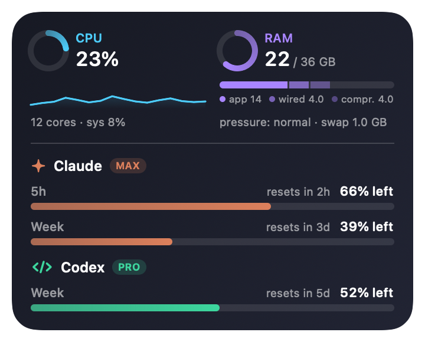
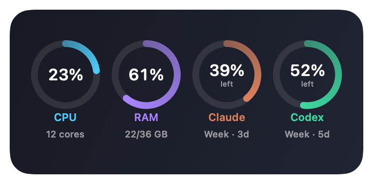

# AI Pulse

Your Mac's load and your AI subscription limits in one place: **CPU**, **memory**, **Claude** (claude.ai Pro/Max) and **Codex** (ChatGPT). Lives in the menu bar and as a card on your desktop.

<p>
  
  
</p>

**[⬇ Download AI Pulse for Mac (DMG)](https://github.com/mikhailpopov6/ai-pulse/releases/latest/download/AI-Pulse.dmg)** · macOS 14+ · Apple Silicon

## What it shows

| Metric | What you see | Source |
|---|---|---|
| **CPU** | load, a graph of the last minutes, system share | macOS (Mach API) |
| **RAM** | used / total, app · wired · compressed, memory pressure, swap | macOS (Mach API, sysctl) |
| **Claude** | how much of the 5-hour and weekly limit is **left**, time to reset, plan | claude.ai — the same source as `/usage` in Claude Code |
| **Codex** | how much of the limit is **left** (weekly on Pro), time to reset, plan | Codex itself: `codex app-server` |

Limits are shown as what's left, like Codex does ("44% left"). Colors warn you: yellow at 75% used, red at 90%. The RAM ring follows memory pressure rather than the percentage, because macOS keeps memory nearly full by design.

## Where it shows

- **Menu bar.** An icon with CPU and RAM; click it for the full panel.
- **Desktop card.** Sits below your windows, shows on every Space, updates every 2 seconds.
  - Three styles: **Large** (same as the menu bar panel), **Small** (the same at 80%), **Rings** (four rings in a row).
  - Switch styles in the AI Pulse menu ("Desktop" row) or by right-clicking the card.
  - Drag it anywhere. The position is remembered **per set of displays**: one spot with an external monitor, another on the laptop alone. Plug the monitor in and the card moves to its "monitor" spot, unplug it and it moves back.
- **macOS widget** (the "Edit Widgets" gallery). The code is there, but macOS only shows third-party widgets signed with an Apple Development certificate — see [System widget](#system-widget).

## Install

1. [Download `AI-Pulse.dmg`](https://github.com/mikhailpopov6/ai-pulse/releases/latest/download/AI-Pulse.dmg), open it and drag **AI Pulse** to **Applications**.
2. Open AI Pulse from Applications. It lives in the menu bar, with no Dock icon.
3. **First launch only:** AI Pulse is open source and not notarized by Apple, so macOS will say it "could not verify" the app. Open **System Settings → Privacy & Security**, scroll down and click **Open Anyway**. Or run:

   ```bash
   xattr -dr com.apple.quarantine "/Applications/AI Pulse.app"
   ```

AI Pulse adds itself to **Login Items** on first launch, so it starts with your Mac. Turn this off with **Open at login** in its menu or in System Settings → General → Login Items.

**Requirements:** macOS 14 or later, Apple Silicon. For Codex limits — the [Codex CLI](https://github.com/openai/codex) signed in with ChatGPT (`codex login`). For Claude limits — [Claude Code](https://code.claude.com/docs/en/overview) and a claude.ai Pro or Max subscription.

### Build from source

Needs Xcode Command Line Tools (`xcode-select --install`); full Xcode is not required.

```bash
git clone https://github.com/mikhailpopov6/ai-pulse.git
cd ai-pulse
./install.sh       # build, install to ~/Applications and launch
./make_dmg.sh      # or build dist/AI-Pulse.dmg
```

## Connecting your limits

**Codex** is picked up automatically if `codex` is installed and signed in with ChatGPT. AI Pulse asks Codex itself for the limits (`codex app-server`) and never reads Codex's auth files.

**Claude:** click **Sign in to Claude** in the AI Pulse menu. Terminal opens with the claude.ai sign-in; finish it in your browser. The sign-in goes into a **separate config folder** (`~/Library/Application Support/AIPulse/claude-login`), so your main Claude Code setup is untouched — if it runs on an API key or a corporate proxy, it stays that way.

The same thing by hand:

```bash
env -u ANTHROPIC_BASE_URL -u ANTHROPIC_AUTH_TOKEN -u ANTHROPIC_API_KEY CLAUDE_CONFIG_DIR="$HOME/Library/Application Support/AIPulse/claude-login" claude auth login --claudeai
```

## Privacy and security

- **The repository contains no keys, tokens or personal data.**
- Your claude.ai sign-in token lives only in the macOS Keychain, in the item Claude Code itself creates: `Claude Code-credentials-<hash of the config folder>`. AI Pulse reads and refreshes it through the system `/usr/bin/security` tool, keeps it in memory only, and never writes it to files, logs or command-line arguments.
- AI Pulse never sees Codex tokens: Codex handles its own authentication.
- Network access: `api.anthropic.com` (Claude limits) and `platform.claude.com` (Claude token refresh). Codex does its own networking. Nothing else.
- AI Pulse itself writes only percentages and reset times (`snapshot.json`), a small event log (`aipulse.log`) and the sign-in script `claude-login.command`, which holds the sign-in command and no secrets.

## Files

| What | Where |
|---|---|
| App | `/Applications/AI Pulse.app` (DMG) or `~/Applications/AI Pulse.app` (`install.sh`) |
| Start at login | System Settings → General → Login Items |
| Metrics snapshot for the widget | `~/Library/Application Support/AIPulse/snapshot.json` |
| Event log (card moves, login item) | `~/Library/Application Support/AIPulse/aipulse.log` |
| claude.ai sign-in config | `~/Library/Application Support/AIPulse/claude-login/` |
| claude.ai token | Keychain, `Claude Code-credentials-<hash>` |
| Settings (card style and positions) | `defaults read local.aipulse` |

`./uninstall.sh` removes everything in this table.

## Update frequency

| Data | How often |
|---|---|
| CPU, RAM | every 2 seconds |
| Codex | every minute |
| Claude | every ~1.5 minutes; if claude.ai answers "too many requests" (429), AI Pulse pauses for 5 minutes |
| "Refresh" button | immediately |

## Language

The app follows your system language: English by default, Russian if Russian is your first preferred language.

## System widget

The desktop card works without any certificates. To also get AI Pulse in the system widget gallery ("Edit Widgets"), the app has to be signed with an Apple Development certificate: macOS (`chronod`) drops ad-hoc signed widgets.

1. Install Xcode and sign in with your Apple ID: Xcode → Settings → Accounts. A free account is enough.
2. In the same place: Manage Certificates → "+" → **Apple Development**.
3. Run `./install.sh`. `build.sh` finds the certificate and signs the app and the widget with it. To pick a specific one, set `AIPULSE_SIGN_ID=<SHA-1 or name>`.

## Troubleshooting

| Symptom | What to do |
|---|---|
| "Apple could not verify AI Pulse" | System Settings → Privacy & Security → Open Anyway (see [Install](#install)) |
| Claude: "sign in to claude.ai" or "sign-in expired" | menu → Sign in to Claude |
| Claude: "claude.ai asks to slow down (429)" | nothing to do: AI Pulse waits 5 minutes on its own |
| Codex: "codex not found" | install the Codex CLI into `~/.local/bin`, `/opt/homebrew/bin` or `/usr/local/bin` |
| The card is in the wrong spot | drag it where you want it; the spot is saved for the current set of displays. See `aipulse.log` for what happened |
| Not in the widget gallery | needs an Apple Development signature, see above |

## Project layout

```
App/         menu bar app: metric collectors, Claude/Codex, desktop card, login item
Widget/      WidgetKit extension (sandboxed, only reads snapshot.json)
Shared/      data model, localization and SwiftUI views shared by the app and the widget
Resources/   Info.plists, entitlements, DMG read-me
tools/       icon generator and PNG previews of the layouts
build.sh     build with swiftc, no Xcode needed
install.sh   build + install to ~/Applications + launch
make_dmg.sh  build dist/AI-Pulse.dmg
```

Details for developers and AI agents are in [AGENTS.md](AGENTS.md).
